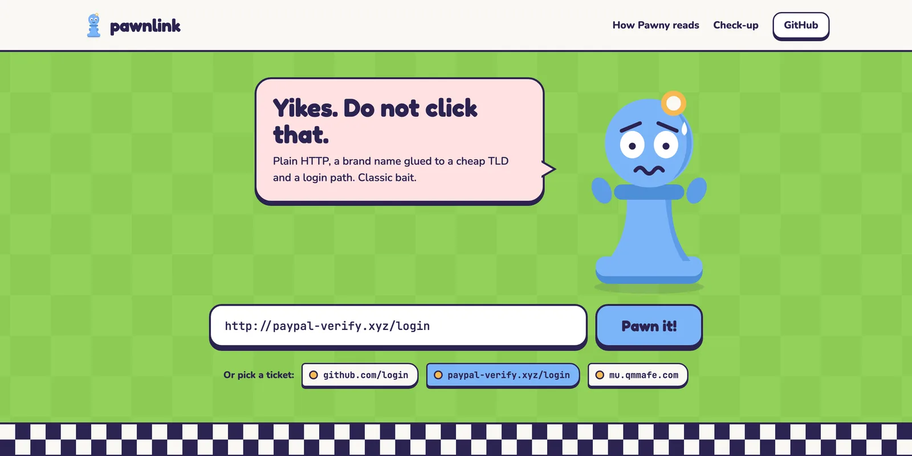
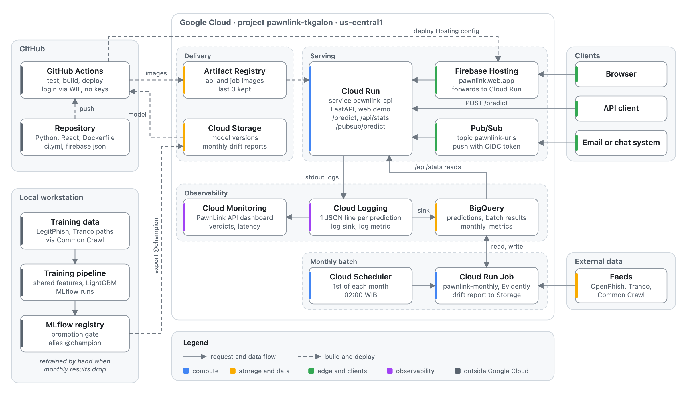
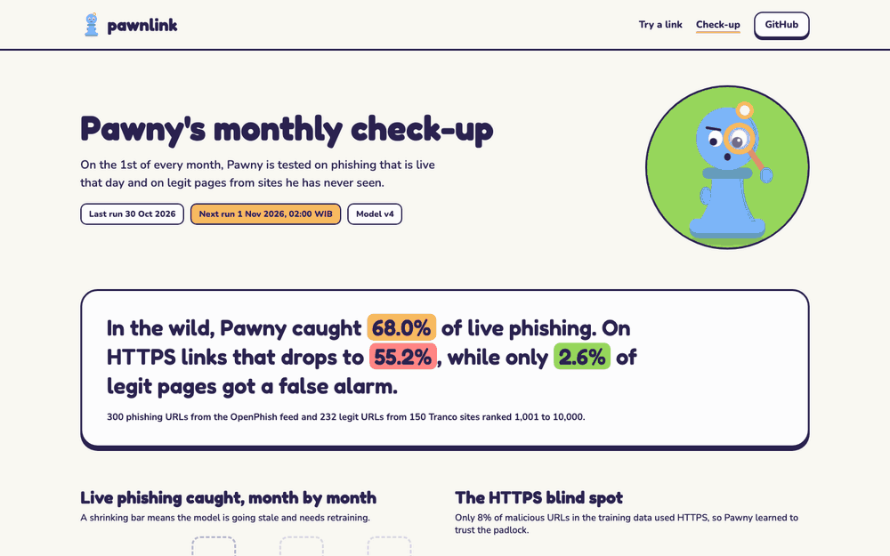
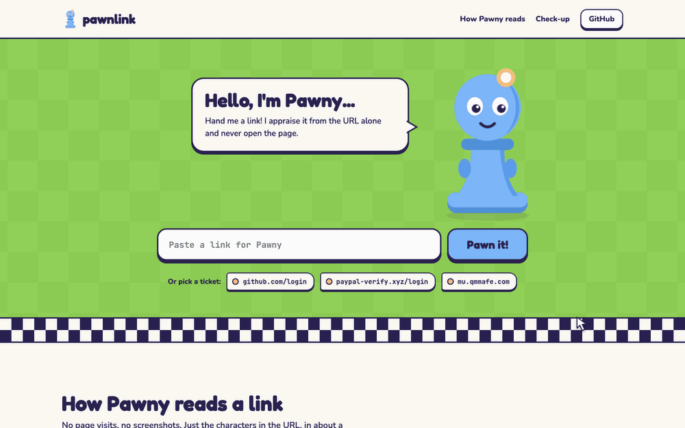

<p align="center">
    
</p>

<h1 align="center">PawnLink</h1>

<p align="center"><em>Paste a link. Pawn it!</em></p>

<p align="center">
    A phishing URL detection service powered by LightGBM, deployed on Google Cloud with real-time,<br>
    batch and stream scoring, monitoring, and gated retraining.
</p>

<p align="center">
    <a href="https://pawnlink.web.app">Demo</a> ·
    <a href="#architecture">Architecture</a> ·
    <a href="#ml-lifecycle">ML lifecycle</a> ·
    <a href="MODEL_CARD.md">Model card</a> ·
    <a href="https://pawnlink.web.app/docs">API docs</a>
</p>

<p align="center">
    
</p>

<p align="center">
    <a href="https://pawnlink.web.app"></a>
    
    
    
    <a href="LICENSE"></a>
</p>

## Overview

The model comes from a phishing URL task in the DSCO 2025 competition. This repo rebuilds it as a service and covers the parts a notebook leaves out:

- **One feature module** imported by both training and the API, so training and serving compute the same 23 features.
- **Experiment tracking and a model registry** in MLflow, with a promotion gate that blocks a model worse than the current `@champion`.
- **CI/CD** on GitHub Actions that tests, builds and deploys to Cloud Run on every push to `main`.
- **Three serving modes**: a real time API, a monthly batch job and a Pub/Sub stream.
- **Monitoring**: every prediction logged to BigQuery, a Cloud Monitoring dashboard, Evidently drift reports and a monthly recall check on live phishing.
- **A web demo** at [pawnlink.web.app](https://pawnlink.web.app) that explains each score.

The model sees only the URL string. It never opens the page, looks up DNS or follows redirects.

## Results

| Metric | v3 | v4 (in production) |
| --- | ---: | ---: |
| Test ROC AUC | 0.9873 | 0.9867 |
| Test recall | 0.980 | 0.978 |
| Legit URLs with paths flagged | 71.8% | 4.2% |
| Live OpenPhish phishing caught, 30 Oct 2026 | | 68.0% |
| Live HTTPS phishing caught, 30 Oct 2026 | | 55.2% |

v3 learned a shortcut: almost every legitimate URL in the training data was a bare homepage, so any URL with a path looked malicious. v4 fixed it with 8,260 legitimate URLs with paths. The live check shows the next problem. Only 8% of malicious URLs in the training data use HTTPS, so the model misses almost half of today's HTTPS phishing. The [model card](MODEL_CARD.md) covers both in detail.

## Architecture

<p align="center"></p>

| Component | Service | Role |
| --- | --- | --- |
| `pawnlink-api` | Cloud Run | FastAPI app serving the API, the web demo, `/api/stats` and the Pub/Sub endpoint. 0 to 1 instance, 512 MiB. |
| `pawnlink.web.app` | Firebase Hosting | Public domain. Forwards every request to Cloud Run. |
| `pawnlink-monthly` | Cloud Run Jobs, Cloud Scheduler | Batch scoring and drift report on the 1st of each month at 02:00 WIB. |
| `pawnlink-urls` | Pub/Sub | Push subscription to the API, verified with an OIDC token. |
| `pawnlink` dataset | BigQuery | Prediction logs from a log sink, batch results and monthly metrics. |
| PawnLink API dashboard | Cloud Monitoring | Requests, latency, instances and predictions by verdict. |
| `pawnlink-tkgalon-models` | Cloud Storage | Exported model versions and monthly drift reports. |
| `pawnlink` repository | Artifact Registry | API and job images, last 3 kept. |

GitHub Actions authenticates through Workload Identity Federation, so no service account key exists anywhere. Every resource has its own cost limit.

## ML lifecycle

### Data

| Source | Rows | Used for |
| --- | ---: | --- |
| LegitPhish, DSCO 2025 version, after dedup | 80,755 | Training, validation, test |
| Legit URLs with paths, Tranco top domains via Common Crawl `CC-MAIN-2026-43` | 8,260 | Training, and a separate test of 1,202 URLs from unseen domains |
| OpenPhish community feed | about 300 a month | Monthly live check |

The dataset's precomputed feature columns are not used. Several disagree with their own URLs and leak the label through noise, see [reports/feature_comparison.md](reports/feature_comparison.md). Every feature is computed from the raw URL by `pawnlink.features.extract`.

### Training and promotion

`pawnlink.training.train` fits LightGBM, picks the threshold with the best F1 on validation and logs the run to MLflow with its git commit. It refuses to run on uncommitted changes.

`pawnlink.training.promote` scores the candidate and the `@champion` on the same files and moves the alias only if:

- test ROC AUC drops by at most 0.005,
- test recall drops by at most 0.01,
- fewer legitimate URLs with paths are flagged.

`pawnlink.training.export` writes the champion to `models/` with its threshold and a sample of training URLs for drift reports.

### CI/CD

The workflow in [.github/workflows/ci.yml](.github/workflows/ci.yml) runs on pushes and pull requests to `main`:

1. **test**: ruff and pytest.
2. **frontend**: typecheck, unit tests and build of the web demo.
3. **docker**: builds the image with a dummy model and smoke tests the container.
4. **deploy**, on `main` only: downloads model `v$MODEL_VERSION` from Cloud Storage, builds the API and job images, deploys Cloud Run, the monthly job and Firebase Hosting, then smoke tests the live URLs.

A push reaches production in about 4 minutes. The served model is chosen by `MODEL_VERSION` in the workflow, so a model release is a one line commit and a rollback is its revert.

### Serving

| Mode | Entry point | Notes |
| --- | --- | --- |
| Real time | `POST /predict` | One URL. Add `?explain=true` for the top 5 SHAP reasons and the URL split into parts. |
| Batch | `POST /predict/batch`, `pawnlink-monthly` | Up to 100 URLs per request, or the whole OpenPhish feed once a month. |
| Stream | Pub/Sub topic `pawnlink-urls` | Pushed to `/pubsub/predict`. Bad messages are acknowledged and logged so they are not redelivered forever. |

```sh
curl -X POST https://pawnlink.web.app/predict \
  -H 'Content-Type: application/json' \
  -d '{"url": "http://paypal-verify.xyz/login"}'
```

```json
{
  "url": "http://paypal-verify.xyz/login",
  "score": 0.989,
  "is_phishing": true,
  "model_version": "4",
  "threshold": 0.3844,
  "latency_ms": 1.4
}
```

The service scales to zero, so the first request after a quiet period waits a few seconds for a cold start.

### Monitoring

Labels never come back for URLs sent to the API, so daily monitoring watches inputs and outputs, and quality is measured once a month on URLs whose label is already known.

- **Prediction log.** Each prediction is one JSON line on stdout. A log sink copies them into BigQuery, kept for 90 days.
- **Dashboard.** Cloud Monitoring shows request classes, latency percentiles, instances and a log based metric of predictions by verdict.
- **Drift.** Evidently compares the month's URLs with the training sample. A simulated shift to legitimate URLs with paths flags 21 of 24 columns.
- **Live check.** The monthly job measures recall on OpenPhish and the false alarm rate on fresh legitimate pages, and writes both to `monthly_metrics`. The [check-up page](https://pawnlink.web.app/stats/) reads them through `/api/stats`.

<p align="center">
    
</p>

### Retraining

Retraining is started by hand when the monthly numbers drop or new labelled data closes a known gap, as v4 did for URLs with paths. A new model has to pass the promotion gate before it is exported, and only reaches users through the CI deploy above.

## Web demo

Hand Pawny a link and watch it break the URL into parts, weigh the risk and explain which features pushed the score toward safe or sketchy. Built with React, Vite and TypeScript, and served alongside the API by FastAPI.

<p align="center">
    
</p>

## Running locally

Requires Python 3.11, [uv](https://docs.astral.sh/uv/) 0.12 and Node 22.

```sh
git clone https://github.com/tkgalon/PawnLink.git
cd PawnLink
uv sync
uv run ruff check .
uv run pytest
```

Train from scratch with the competition's `train.csv` in `data/raw/`:

```sh
uv run python -m pawnlink.training.data
uv run python scripts/fetch_legit_urls.py
uv run python -m pawnlink.training.data
uv run python -m pawnlink.training.train
uv run python -m pawnlink.training.promote --init 1
uv run python -m pawnlink.training.export
```

`data` runs twice because the URL fetch skips domains found among the malicious URLs, and the second run adds the fetched URLs to the splits. `--init` makes the first model the champion. Later models go through the gate with a plain `promote`.

Serve the exported model and the web demo:

```sh
uv run uvicorn pawnlink.api.main:app --port 8080

cd frontend
npm ci
npm run dev
```

Vite forwards API calls to port 8080. Frontend checks are `npm test` and `npx playwright test`. The monthly job can run without writing to the cloud with `uv run python -m pawnlink.monitoring.monthly --dry-run`.

## Project layout

```
src/pawnlink/
├── features/      URL to features, shared by training and serving
├── training/      data splits, LightGBM, promotion gate, export
├── api/           FastAPI app, explanations, stats, Pub/Sub
├── monitoring/    drift report and the monthly job
└── sources.py     OpenPhish, Tranco and Common Crawl
frontend/          web demo
infra/             dashboard, log metric, registry cleanup policy
scripts/           data fetch, drift scenarios, smoke test
reports/           feature comparison from the first phase
MODEL_CARD.md      data, evaluation, limitations
```

## Data and credits

Training data is the **LegitPhish** dataset:

> Potpelwar, R., Kulkarni, U., & Waghmare, J. (2025). *LegitPhish Dataset* (Version 2). Mendeley Data. https://doi.org/10.17632/hx4m73v2sf.2

It is used under [CC BY 4.0](https://creativecommons.org/licenses/by/4.0/), with a companion paper in [Data in Brief, 2025](https://pmc.ncbi.nlm.nih.gov/articles/PMC12538017/). The copy used here is the one from the DSCO 2025 competition, and all code in this repo was written for this project.

Legitimate URLs with paths come from the [Tranco list](https://tranco-list.eu/) and the [Common Crawl](https://commoncrawl.org/) index. Live phishing for the monthly check comes from the [OpenPhish](https://openphish.com/) community feed.

## License

The code is licensed under [MIT](LICENSE). The LegitPhish data keeps its own CC BY 4.0 license and is not included in this repo.
